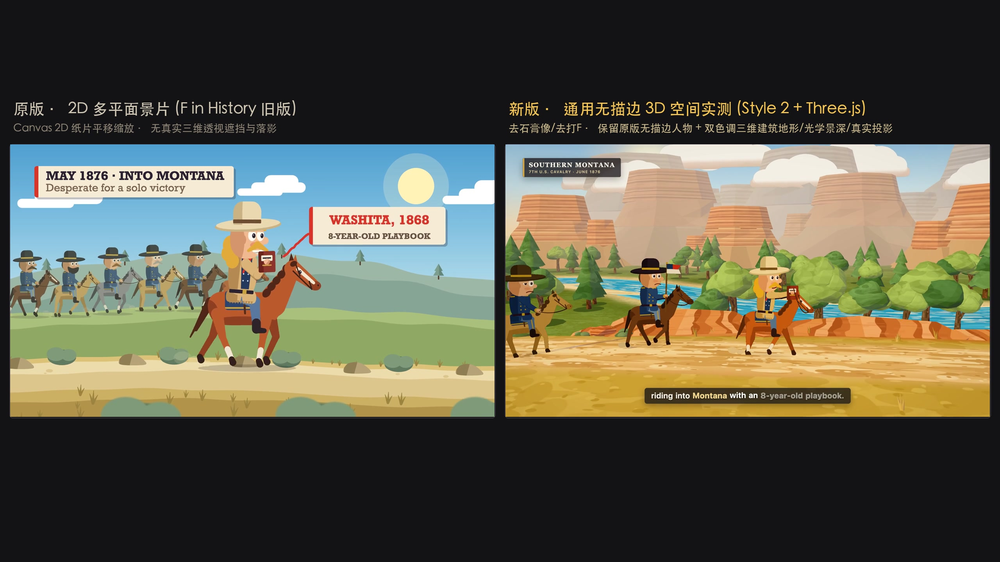

# Lineless 3D Video (`lineless-3d-video`)

Universal agent skill (Claude Code, Codex, Antigravity) for producing narrated historical, biographical, science, business, and documentary animation combining **Style 2 lineless colour-block 2D characters & cavalry** with **Three.js two-tone 3D architecture, terrain, real directional shadows, and thin-lens optical depth of field** (`2560×1440` 2K @ 30fps, `-14 LUFS`).

Unlike channel-specific classroom formats, `lineless-3d-video` contains **no marble-bust teacher and no exam/red-pen grading gimmicks** — using clean documentary location datelines, sparse turning-point badges, semantic word-highlighted captions, and a modular library of **1,007 CC0 `.glb` 3D assets** automatically normalized and re-shaded into unified two-tone colour blocks.




## Key Capabilities

- **Authentic Style 2 Lineless 2D Cast in 3D Space** (`style2Rig.js` + `linelessCast.ts`): Rounded capsule heads, warm soft eyes, 20+ tailored two-tone outfits, sculpted cuff+thumb hands, 24 props, word-gated `speechOpen()` lip sync, full-length rear OTS figures, and side-view horses casting real 3D silhouette shadows (`customDepthMaterial`).
- **Lineless Storybook 3D Worlds (`twoTone` Shader)**: Zero comic black outlines (`InkPass` off) so 3D architecture and terrain match lineless 2D characters seamlessly; real 3D window/doorway portals, warm-umber AO baseboard strips, volumetric sun shafts, and `LensBlur` shallow optical bokeh.
- **1,007 Reusable CC0 `.glb` Assets + Auto-Normalizer** (`download_cc0_kits.py` + `glbAssetKit.ts`): Pulls 8 curated Kenney CC0 3D kits (`furniture`, `nature`, `fantasy-town`, `train`, `survival`, `castle`, `pirate`, `city-suburban`), indexes exact `[width, height, depth, minY]` bounds into `catalog.json`, grounds every model flush at `y = 0`, scales to real-world meter heights, and converts materials to `twoTone()` automatically.
- **Narrated Timeline & Broadcast Mastering**: Bundled Gemini 3.8 Flash TTS (`Fenrir`, `compact-shortform-v3`), `mlx-whisper` word alignment (`words.py`), and frame-accurate Foley SFX mastering (`-14 LUFS`).

## Install

### Claude Code
```bash
mkdir -p ~/.claude/skills
git clone https://github.com/doulaver834-ux/lineless-3d-video.git ~/.claude/skills/lineless-3d-video
```

### Codex
```bash
mkdir -p ~/.codex/skills
git clone https://github.com/doulaver834-ux/lineless-3d-video.git ~/.codex/skills/lineless-3d-video
```

## Quick Start

```bash
K=~/.claude/skills/lineless-3d-video/scripts

# 1. Scaffold a new 3D project (links local cached node_modules & 1,007 GLB kits if present, or pass --download-assets)
python3 "$K/setup_lineless_3d.py" ./my-episode --download-assets

# 2. Render lookdev QA stills first, then full 2K (2560x1440 @ 30fps) master
cd ./my-episode
node scripts/render.mjs --stills
node scripts/render.mjs
```

See [SKILL.md](SKILL.md), [Architecture & Craft Rules](references/architecture-and-craft.md), and [3D GLB Asset Pipeline](references/assets-and-pipeline.md) for full details.

[MIT License](LICENSE) (3D asset downloader pulls CC0 1.0 Public Domain packs from Kenney.nl)
