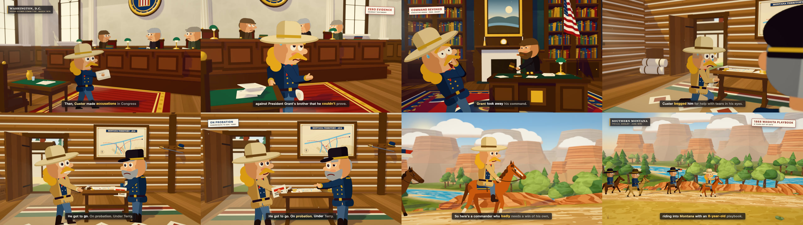

# Lineless 3D Video (`lineless-3d-video`)

Universal pure-code video agent skill for **Gemini (Antigravity / Gemini CLI)**, **Claude Code**, and **Codex**.

Turn any historical, biographical, business, or science script into **2K (`2560×1440 @ 30fps`, `-14 LUFS`)** YouTube animation combining **Style 2 lineless 2D characters & riders** with **Three.js two-tone 3D architecture, terrain, real directional shadows, and thin-lens optical depth of field** — no Blender, no timeline editor, and no AI video gacha credits required.

### Contemporary 4-Set Cinema Benchmark (`2K · 49s · 12 Shots`)


### Historical Frontier & Interiors Benchmark (`2K · 20s · 4 Sets`)


---

## Why Pure-Code 3D Instead of AI Video Generation?

- **Zero character drift**: Lineless 2D skeletal rigs (`style2Rig.js` + `linelessCast.ts`) cast real 3D silhouette shadows (`customDepthMaterial`) with word-gated lip sync (`speechOpen()`), staying 100% consistent across 100+ shots.
- **True 3D space & camera physics**: Real open doorways and windows looking into exterior depth, optical `LensBlur` bokeh on over-the-shoulder close-ups, volumetric sun shafts, and sweeping crane moves (`twoTone` shader, zero comic black outlines).
- **Deterministic & editable**: Change a camera angle, pacing beat, or hero prop animation by editing code instead of re-rolling video prompts.
- **1,007 Free CC0 3D Assets Included via Auto-Downloader**: `download_cc0_kits.py` pulls 8 curated Kenney CC0 `.glb` packs (`furniture`, `nature`, `fantasy-town`, `train`, `survival`, `castle`, `pirate`, `city-suburban`), indexes exact meter bounds into `catalog.json`, grounds every model at `y = 0`, and converts materials to `twoTone()` automatically.
- **Bring Your Own Voice**: Drop any narration audio file (`assets/audio/narration.wav` — recorded yourself or generated with any voice tool you like) and the pipeline auto-aligns word-level timestamps (`words.json`), lip-sync, captions, and `-14 LUFS` procedural Foley SFX.

---

## Install

### Gemini CLI
```bash
mkdir -p ~/.gemini/skills
git clone https://github.com/hideaway007/lineless-3d-video.git ~/.gemini/skills/lineless-3d-video
```

### Antigravity / Claude Code / Codex
```bash
# Antigravity (clone or symlink into your skills directory)
git clone https://github.com/hideaway007/lineless-3d-video.git ~/.antigravity/skills/lineless-3d-video

# Claude Code
mkdir -p ~/.claude/skills
git clone https://github.com/hideaway007/lineless-3d-video.git ~/.claude/skills/lineless-3d-video

# Codex
mkdir -p ~/.codex/skills
git clone https://github.com/hideaway007/lineless-3d-video.git ~/.codex/skills/lineless-3d-video
```

After installing, prompt your agent:
> *"Use `lineless-3d-video` to create a 45-second 2K 3D animated YouTube video about [your topic]."*

---

## Prerequisites

- **Node.js 20+**, **Python 3.10+**, and **`ffmpeg`** on `PATH`
- **Your own narration audio**: place any WAV/MP3 narration file at `<project>/assets/audio/narration.wav`
- **Word timestamps**: `pip install mlx-whisper` (Apple Silicon Mac) or `pip install openai-whisper` (Linux / Windows / Intel Mac)
- **Foley SFX mastering**: `uv` (or `pip install numpy scipy`)

---

## Quick Start (CLI)

```bash
K=~/.gemini/skills/lineless-3d-video/scripts   # adjust to your skills path

# 1. Scaffold a new 3D project & download the 1,007 CC0 .glb assets into public/assets/
python3 "$K/setup_lineless_3d.py" ./my-episode --download-assets
cd ./my-episode && npm install

# 2. Drop your narration audio into assets/audio/narration.wav & extract word timestamps
python3 "$K/words.py" . assets/audio/narration.wav

# 3. Synthesize action-locked Foley SFX mastered to -14 LUFS
uv run --with numpy --with scipy python3 scripts/audio.py

# 4. Run mandatory lookdev stills QA first, then render the full 2K (2560x1440 @ 30fps) master
node scripts/render.mjs --stills
node scripts/render.mjs
```

---

## What's Inside

- [`SKILL.md`](SKILL.md) — Complete agent operating specification & multi-subagent parallel workflow
- [`references/quality-bar.md`](references/quality-bar.md) — Production density bar (≥3 scenes, animated hero props, subagent briefs, stills QA)
- [`references/architecture-and-craft.md`](references/architecture-and-craft.md) — 3D set craft, optical `LensBlur`, contemporary cast kits, and `createHugActor`
- [`references/assets-and-pipeline.md`](references/assets-and-pipeline.md) — 1,007 CC0 `.glb` loader (`instantiateLinelessGlb`) and rendering rules
- [`references/script.md`](references/script.md) — Visual script linting and `[air]` breath pauses
- [`examples/benchmark_modern_cinema_3d/`](examples/benchmark_modern_cinema_3d/) & [`examples/benchmark_1876_3d/`](examples/benchmark_1876_3d/) — Two verified 2K reference benchmarks

---

## License

[MIT License](LICENSE). The bundled asset downloader (`scripts/download_cc0_kits.py`) fetches CC0 1.0 Public Domain 3D packs from [Kenney.nl](https://kenney.nl).
