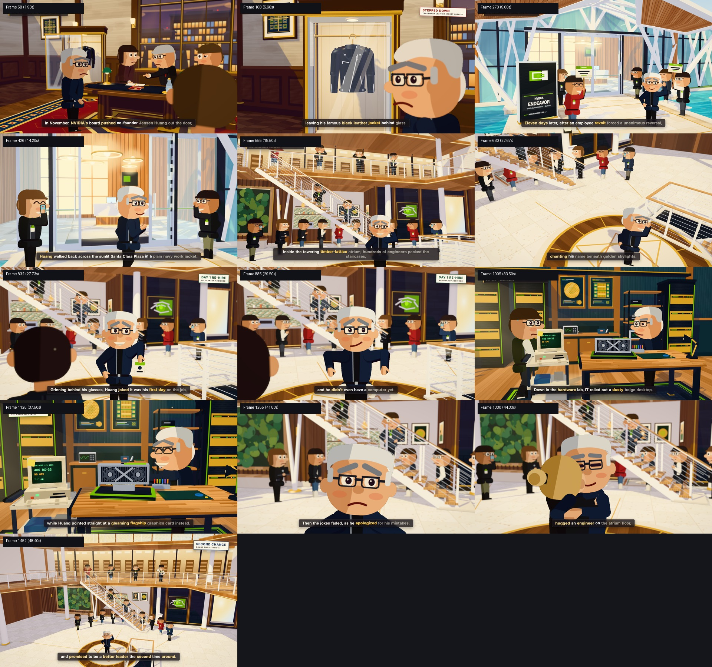

# Contemporary 4-Set Cinema Benchmark (2K, 49.1s)

This reference production validates `lineless-3d-video` on modern corporate / tech-campus storytelling (`2560×1440 @ 30fps`, `-14 LUFS`, `49.10s`):

- **4 independent 3D worlds** (~8,466 LOC across 4 parallel set-architect subagents):
  1. **Dusk Walnut Boardroom** — twilight skyline glazing, walnut paneling, animated glass vitrine housing a custom-modeled 3D leather moto jacket
  2. **Sunlit Santa Clara Plaza** — architectural campus exterior, palms & water features, real open 3D sliding glass entrance portal looking into lobby depth
  3. **Three-Story Timber Lattice Atrium** — soaring cedar diagrid skylights, volumetric sun shafts, tiered staircases packed with Z-staggered cheering engineers, proportion-matched two-person embrace (`createHugActor`), and a 6m 3D crane ascent
  4. **Slate-Teal Hardware Provisioning Lab** — contrasting palette, retro beige 486 CRT cart vs. animated spinning 25-fin 3D flagship GPU hero prop
- **12 camera setups** with optical `LensBlur` on OTS close-ups and crisp deep focus (`aperture: 0`) on grand crane shots
- **Audio**: Gemini TTS (`Fenrir`, native pace) + `mlx-whisper` word timestamps + action-locked Foley SFX mastered to `-14 LUFS`
